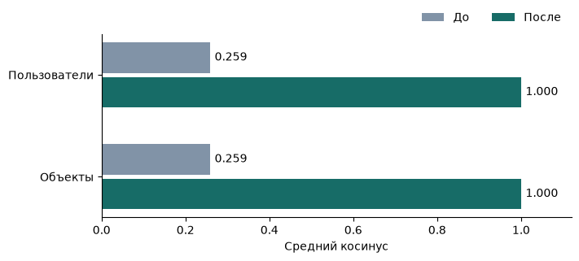
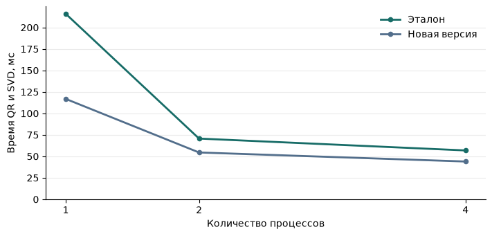

# Распределённая стабилизация эмбеддингов

Проект выравнивает эмбеддинги пользователей и объектов между версиями рекомендательной модели. Преобразование сохраняет скалярные произведения «пользователь - объект» внутри версии с учётом численной точности. Данные генерируются при запуске.

## Результаты

### Сходство эмбеддингов до и после выравнивания

При повороте второй версии на 75° средний косинус вырос с **0,259 до 1,000** и для пользователей, и для объектов. Относительная ошибка скалярных произведений в `float64` составила около **2 × 10⁻¹⁵**.



### Время расчёта на CPU

На наборе из 65 536 пользователей и 49 152 объектов при размерности 64 расчёт QR и SVD для новой версии занял **117 мс** на одном процессе и **44 мс** на четырёх. На графике показано по одному замеру на конфигурацию. Запуск процессов и генерация данных в замер не входят.



Графики взяты из [ноутбука](notebooks/demo.ipynb). Параметры и результаты запусков приведены в [отчёте](REPORT.md).

## Быстрый запуск

Откройте терминал в папке проекта. Если зависимости уже установлены в выбранном окружении Python, пропустите первую команду.

```powershell
python -m pip install -r requirements-notebook.txt
python -m stabilization demo
python -m stabilization.launch --processes 2 demo
python -m jupyterlab notebooks/demo.ipynb
```

В JupyterLab выберите **Run → Run All Cells**. Ноутбук выполняет локальный расчёт, показывает графики и читает сохранённые метрики из `results/`. В разделе «Повтор распределённого запуска» можно запустить два процесса из ноутбука. Для работы только с терминалом достаточно `requirements.txt`.

## Режимы расчёта

| Режим | Действие |
| --- | --- |
| `reference` | Строит эталон версии 0 и сохраняет две матрицы преобразования. |
| `align` | Загружает эталон, строит преобразование версии 1 и выравнивает её по объектам версии 0. |
| `demo` | Выполняет оба шага за один запуск без файла эталона. |

```powershell
python -m stabilization reference --reference runs/reference.pt --output runs/reference.json
python -m stabilization.launch --processes 2 align --reference runs/reference.pt --noise 0.15 --output runs/align-noise.json
python -m stabilization demo --device cuda
python -m unittest discover -s tests -v
```

Эталон для синтетического сценария содержит преобразования, размерности и seed. По ним каждый процесс восстанавливает свой блок версии 0. Число процессов при создании эталона и выравнивании может различаться. Параметр `--noise` добавляет независимое возмущение второй версии. Параметр `--output` сохраняет JSON с метриками, параметрами и временем отдельных шагов. Все параметры доступны через `python -m stabilization --help`.

## Дополнительные эксперименты

Все сценарии используют синтетические эмбеддинги. В [дополнительном ноутбуке](notebooks/experiments.ipynb) есть сравнение методов, график бенчмарка и результаты обработки файлов.

```powershell
python -m stabilization.ablation --output runs/ablation.json
python -m stabilization.benchmark --sizes 4096 65536 262144 --output runs/qr-benchmark.json
python -m jupyterlab notebooks/experiments.ipynb
```

В первом эксперименте координаты объектов масштабируются, а координаты пользователей меняются обратно. Затем обе матрицы поворачиваются. Сравниваются исходные эмбеддинги, только Прокруст, только SVD и полный метод. Половина объектов выделена для оценки. Бенчмарк сравнивает QR и TSQR с одинаковым общим числом потоков CPU. Подробности и результаты приведены в [отчёте](REPORT.md#дополнительные-эксперименты).

### Обработка файлов блоками

Для проверки в ноутбуке установите `check_local_run = True`. Ячейка сама создаст недостающие синтетические файлы и результаты в `runs/`. При повторном запуске она использует готовые файлы. Те же шаги можно выполнить вручную.

```powershell
python -m stabilization.streaming generate --users 8192 --items 6144 --dim 32 --block-rows 127 --output runs/stream-input
python -m stabilization.launch --processes 2 --module stabilization.streaming reference --input runs/stream-input/version0 --block-rows 127 --output runs/stream-reference
python -m stabilization.launch --processes 4 --module stabilization.streaming align --input runs/stream-input/version1 --reference runs/stream-input/version0 --checkpoint runs/stream-reference/transforms.pt --block-rows 127 --output runs/stream-aligned
```

Для каждого входа нужны матрицы `users.npy` и `items.npy` общего типа `float32` или `float64`, а также `user_ids.npy` и `item_ids.npy` со строго возрастающими ID типа `int64`. Векторы хранятся в порядке ID. Выравнивание опирается на общие ID объектов и применяет результат ко всем строкам текущей версии, включая новые ID.

Выходная папка содержит стабилизированные матрицы, ID, `transforms.pt` и `metrics.json`. Для повторного запуска укажите новую выходную папку. Для распределённого файлового режима процессы используют общий каталог. Режим проверен на CPU в Windows. Параметр `--block-rows` ограничивает число строк в одном рабочем блоке тензоров. Итоговое потребление памяти также зависит от файлового кэша и библиотек.

## Распределённый запуск

- CPU использует Gloo. Для сбалансированного дерева TSQR число процессов должно быть степенью двойки.
- На Windows команда `python -m stabilization.launch` передаёт `torchrun` настройки для сборок PyTorch без libuv. Сетевые предупреждения c10d могут появляться при запуске. Код завершения 0 и итоговый JSON подтверждают успешный расчёт.
- На Linux для запуска на одном узле можно вызвать `torchrun --standalone --nproc-per-node=4 -m stabilization demo`. Для нескольких узлов можно запустить этот модуль через `torchrun` с общим rendezvous и степенью двойки в качестве общего числа процессов. Для режима `align` файл эталона должен быть доступен всем процессам.
- CUDA требует сборку PyTorch с поддержкой CUDA. Для распределённого CUDA-запуска требуются NCCL и отдельная видимая GPU на каждый локальный процесс. Проверен один GPU на Windows, многопроцессный NCCL и запуск на нескольких узлах не тестировались.

## Структура проекта

| Файл | Назначение |
| --- | --- |
| `stabilization/synthetic.py` | Генерация блоков данных, поворот и шум. |
| `stabilization/tsqr.py` | Локальное QR и бинарное дерево TSQR. |
| `stabilization/method.py` | SVD-преобразования и выравнивание Прокруста. |
| `stabilization/metrics.py` | Ошибка оценок и косинус между версиями. |
| `stabilization/ablation.py`, `benchmark.py`, `streaming.py` | Сравнение методов, бенчмарк и обработка файлов блоками. |
| `stabilization/runtime.py`, `launch.py`, `__main__.py` | Группа процессов, запуск через `torchrun` и CLI. |
| `notebooks/demo.ipynb` | Разбор алгоритма, численная проверка и графики. |
| `notebooks/experiments.ipynb` | Дополнительные эксперименты и графики. |
| `tests/` | Проверка основного алгоритма, сравнения методов и файлового режима. |
| `results/`, [REPORT.md](REPORT.md) | Конфигурации, результаты и итоговый отчёт. |

Для подключения своих данных передайте локальные блоки обеих матриц в `fit_svd`. Для вызова `align` подготовьте строки общих объектов в одинаковом порядке и разместите соответствующие ID на одном процессе. После расчёта вызовите `transforms.apply(users, items)` для каждого блока. Модули принимают тензоры PyTorch. CLI работает с синтетическими данными.
